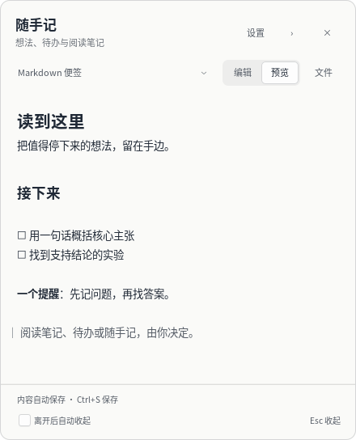
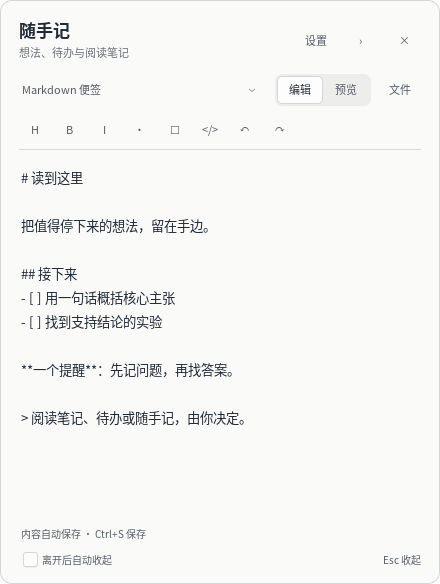
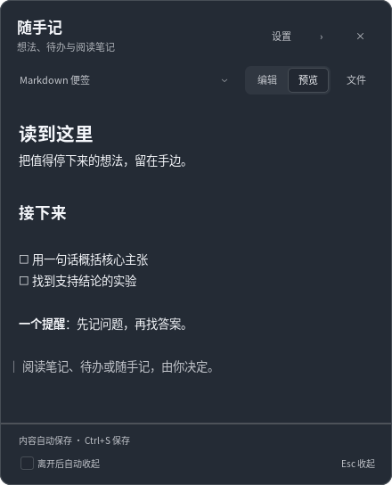
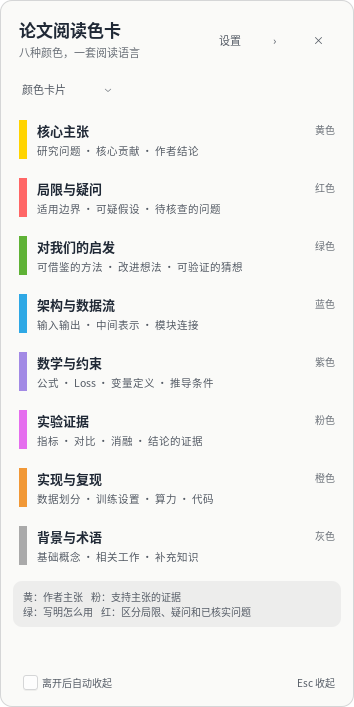

# Paper Color Card · 悬浮便签

[](https://github.com/wcycn/paper-color-card/actions/workflows/tests.yml)
[](LICENSE)

把想法留在手边。一个轻量的 **Linux / GNOME X11 桌面 Markdown 便签**，支持置顶、贴边与收起；你可以自由决定写什么，原有论文阅读色卡也保留为可选模式。

A small, offline GTK 3 floating Markdown note for Linux X11. Write your own notes, preview them, and tuck the window into a screen-edge tab. Includes an optional eight-color reading card.



## 能做什么

- **自由书写**：Markdown 编辑与原生预览、自动保存、撤销重做、格式工具和本地文件导入导出。
- **随时查看**：始终置顶，拖动标题贴到屏幕左右边缘；收起成窄色签，点击、悬停或向内拖动展开。
- **按需调整**：五种主题、自选颜色、标题与副标题；可选鼠标离开后自动收起，默认关闭。
- **继续阅读**：记住位置、收起状态和设置；重复启动展开已有窗口。

运行时不自动访问网络，无网页内核、模型服务或 GPU 依赖。它是独立桌面工具，不读取 Zotero 数据库。

## 快速开始

当前目标环境为 **GNOME + X11、Python 3.10+、GTK 3**。Wayland 暂不支持；多屏、混合缩放和热插拔尚未完成真实硬件验证。

Ubuntu / Debian 可准备以下依赖（命令只安装运行库，项目本身不改系统设置）：

```sh
sudo apt install git python3-gi python3-gi-cairo gir1.2-gtk-3.0 python3-venv

git clone https://github.com/wcycn/paper-color-card.git
cd paper-color-card
python3 -m venv --system-site-packages .venv
.venv/bin/python -m pip install -r requirements.txt
.venv/bin/python launch.py
```

GTK / PyGObject 通过系统包提供，Markdown 解析依赖见 [requirements.txt](requirements.txt)。如果你的 Python 已有全部依赖，可直接运行 `python3 launch.py`。

需要应用菜单入口时运行：

```sh
.venv/bin/python install.py
```

然后在菜单中打开“论文阅读色卡”。安装仅添加本用户的菜单入口，不设置开机自启。菜单保留原名称以便老用户查找，启动后默认使用 Markdown 便签。关闭启动终端不会关闭便签；移动源码目录后需重新运行安装脚本。

## 日常使用

选择“Markdown 便签”，点击“编辑”写内容，切换“预览”查看排版。格式工具栏在编辑时出现；**文件 → 导入 / 导出 Markdown** 可与本地 `.md` 文件交换内容。

导入会替换当前便签内容并保留原文件，可撤销；导出保存一份副本，不与原文件建立同步。单篇便签最多 20 万字。保存失败会保留草稿并提示，可重试或导出。

右上角“设置”调整标题、副标题和主题，支持暖白、纸黄、薄荷、雾蓝、深色与自定义颜色。选择“颜色卡片”继续使用原有色卡，两种模式分别保留内容。

| 操作 | 快捷方式 |
| --- | --- |
| 进入编辑 | Ctrl+E |
| 立即保存 | Ctrl+S（也会自动保存） |
| 撤销 / 重做 | Ctrl+Z / Ctrl+Shift+Z |
| 加粗 / 斜体 | Ctrl+B / Ctrl+I |
| 收起到边缘 | Esc 或标题栏 `›` |
| 退出 | Ctrl+Q 或标题栏 `×` |

拖动标题调整位置，松手后贴近左边或右边；色签也可上下拖动。悬停约 0.4 秒展开。“离开后自动收起”默认关闭，在编辑、设置、文件菜单或文件选择期间暂停。

<details>
<summary>查看编辑、深色主题与原有色卡</summary>





默认分类：黄色＝核心主张；红色＝局限与疑问；绿色＝对我们的启发；蓝色＝架构与数据流；紫色＝数学与约束；粉色＝实验证据；橙色＝实现与复现；灰色＝背景与术语。

色卡内容可在“设置 → 色卡内容”中编辑、添加、删除或恢复默认。最多 32 条，每条正文最多 4000 字，底部提示最多 2000 字。已有自定义色卡会转成一份初始 Markdown，原色卡仍保留。

</details>

## Markdown 范围

支持标题、段落、加粗、斜体、删除线、列表、嵌套列表、待办标记、引用、行内代码、代码块、分隔线、链接和文字表格。预览可选择复制；Ctrl+点击链接由系统浏览器打开。

图片显示为文字占位；原始 HTML 按文字显示，不执行脚本。当前不渲染 LaTeX 公式、Mermaid 或代码语法高亮。便签是单篇本地文档，暂不提供笔记库、云同步或所见即所得编辑。

## 本地数据与升级

正文和偏好存放在 `${XDG_CONFIG_HOME:-~/.config}/paper-color-card/settings.json`，原子写入，文件权限仅本人可读写。日志在 `${XDG_STATE_HOME:-~/.local/state}/paper-color-card/application.log`。个人笔记、设置、日志和缓存不纳入 Git；首页截图使用脚本生成的公开示例。

退出便签后，在源码目录执行 `git pull --ff-only` 并重新启动即可升级；若依赖有变化，在同一个 Python 环境重新安装 `requirements.txt`。更新代码保留本机内容，备份时单独复制自己的设置文件。

## 开发与反馈

```sh
python3 -B -m unittest -v test_palette_core test_markdown_core
```

- [完整验证流程与兼容边界](docs/TESTING.md)：虚拟桌面回归与真实 GNOME/X11 验证。
- [参与改进](CONTRIBUTING.md)：报告问题、开发约束与提交说明。
- [界面风格](docs/DESIGN.md)：纸感规则、视觉反馈与截图生成方式。
- [问题与建议](https://github.com/wcycn/paper-color-card/issues)：请注明桌面环境、缩放和复现步骤，移除私人内容。

主要模块：`paper_color_card.py` 管理窗口与交互；`markdown_view.py` 管理编辑和预览；`markdown_core.py` 解析 Markdown 与文件交换；`palette_core.py` 管理配色、设置与定位；`note_editor.py` 管理设置草稿。`launch.py` 和 `install.py` 负责独立启动及应用菜单入口。

使用 [MIT License](LICENSE)。
