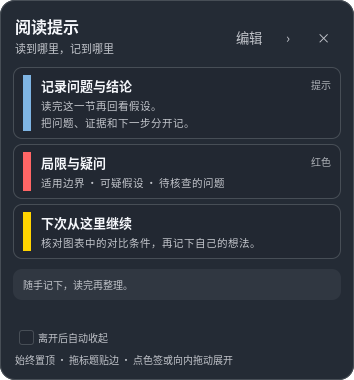

# 论文阅读色卡

一个轻量的 Linux / GNOME X11 悬浮提示便签。默认显示八色论文阅读对照卡，也可以编辑成自己的待办、阅读提醒或常用提示。

A lightweight GTK 3 floating note for Linux X11, with editable content, color themes, edge docking and a collapsible tab. No network or model service is required.




## 使用

- 运行 `python3 paper_color_card.py`，或者安装后在应用菜单搜索“论文阅读色卡”。
- 点击右上角“编辑”或按 Ctrl+E，修改标题、副标题、提示内容和主题颜色。
- 提示支持多行文字、独立颜色和可选短标签；可添加或删除条目，默认八色内容可随时恢复。
- 主题提供暖白、纸黄、薄荷、雾蓝和深色，也可自选背景与边缘色签颜色；文字颜色自动适应背景。
- 编辑窗口中点击“保存”或按 Ctrl+S 后立即生效；“取消”、Esc 或关闭编辑窗口会放弃本次草稿。保存失败会保留草稿并显示错误。
- 色卡始终置顶，显示在工作区上；拖动标题后会吸附到当前显示器的左边或右边。
- 点击标题的 `›` 或按 Esc 收起，只保留屏幕边缘的窄色签。
- 点击色签、悬停约 0.4 秒，或向屏幕内拖动后松手，即可展开。
- 色签也可以上下拖动。主卡与色签互斥显示，不会在相邻显示器上留下另一半窗口。
- 可勾选“离开后自动收起”，鼠标离开约 0.75 秒后收起。默认关闭。
- 标题 `×` 或 Ctrl+Q 退出。重复启动只展开已有窗口，不创建多份实例。
- 记住显示器、左右侧、纵向位置、收起状态和自动收起偏好，以及自定义内容和主题。
- 内容较长时在卡片内部滚动；最多 32 条提示，每条正文最多 4000 字，底部提示最多 2000 字。

## 配色

黄色：核心主张；红色：局限与疑问；绿色：对我们的启发；蓝色：架构与数据流；
紫色：数学与约束；粉色：实验证据；橙色：实现与复现；灰色：背景与术语。

## 安装和配置

需要 Python 3、PyGObject 和 GTK 3。已存在这些库时不需要额外安装。

`python3 install.py` 只添加本用户的应用菜单入口，不修改系统目录，不开启登录自启。
菜单入口通过 `launch.py` 独立启动窗口，关闭启动它的终端或聊天不会关闭色卡。

设置保存在 `${XDG_CONFIG_HOME:-~/.config}/paper-color-card/settings.json`，原子写入且仅本人可读写。
已有版本的设置可以继续使用，原有位置和行为偏好不变，首次升级补充默认内容与主题。
便签内容只保存在本机。仓库不包含个人设置、运行日志或缓存；程序不读取或修改 Zotero 数据库，不操作研究代码、训练进程或系统设置。
源码与图标的位置可搬动；搬动后重新运行安装命令更新菜单入口即可。

## 验证

```sh
python3 -m unittest -v test_palette_core
# 图形冒烟测试：隔离会话，不启动其他桌面服务
dbus-run-session --config-file=tests/session.conf -- \
  env NO_AT_BRIDGE=1 GSETTINGS_BACKEND=memory \
  xvfb-run -a -s '-screen 0 1280x900x24' python3 paper_color_card.py \
  --smoke-test --config-dir /tmp/color-card-test --snapshot /tmp/color-card.png

# 鼠标交互、编辑保存、单实例与进程重启恢复；使用新的临时目录
dbus-run-session --config-file=tests/session.conf -- \
  env NO_AT_BRIDGE=1 GSETTINGS_BACKEND=memory \
  xvfb-run -a -s '-screen 0 1280x900x24' python3 check_desktop.py

# 在真实 X11 桌面验证置顶（会短暂显示测试窗口并移动鼠标）
dbus-run-session --config-file=tests/session.conf -- \
  env NO_AT_BRIDGE=1 GSETTINGS_BACKEND=memory \
  python3 check_desktop.py --require-wm
```

交互测试另外需要 D-Bus、X11 的 XTest 库，虚拟屏幕测试需要 Xvfb；这些不属于工具运行时依赖。
测试内容和截图默认写入临时目录，鼠标位置会在测试后恢复。真实桌面测试请在没有其他鼠标操作时运行。

GTK 置顶是对窗口管理器的请求。本工具以 GNOME/X11 为当前支持环境，已在 GNOME/X11 的统一 2 倍缩放桌面完成置顶和交互测试；Xvfb 测试不能证明窗口管理器置顶行为。
多屏跨屏拖动、混合缩放、热插拔尚未完成真实硬件验证。Wayland 下主动提示不支持，不声称能绕过其他窗口管理器或全屏独占程序的策略。

## 文件

- `paper_color_card.py`：悬浮窗口、贴边、色签与单实例交互。
- `note_editor.py`：内容与主题编辑窗口；保存前只修改草稿。
- `palette_core.py`：默认配色、主题对比度、设置迁移与定位逻辑。
- `test_palette_core.py`、`check_desktop.py`：单元测试与可选 X11 图形交互验证。
- `launch.py`、`install.py`：独立启动与本用户应用菜单安装，不设置开机自启。
