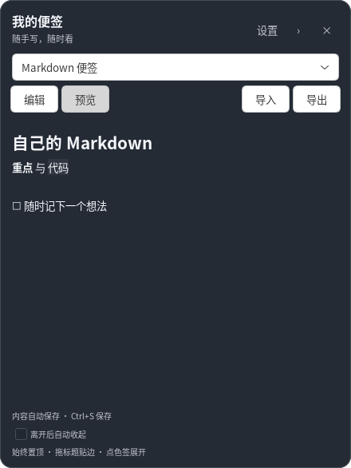
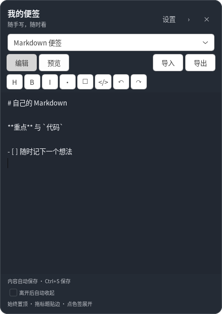

# 悬浮 Markdown 便签 / 论文阅读色卡

一个轻量的 Linux / GNOME X11 桌面悬浮便签。你可以自由编辑整篇 Markdown，把它用于待办、阅读笔记、常用命令或随手记；原有八色色卡保留为可选模式。

A lightweight GTK 3 floating Markdown note for Linux X11, with native preview, local autosave, themes, edge docking and a collapsible tab. The original eight-color reading card remains available.





## 使用

- 从应用菜单打开“论文阅读色卡”，或在本目录运行 `python3 launch.py`。
- 上方选择“Markdown 便签”，点击“编辑”自由写内容，点击“预览”查看排版。
- 内容自动保存到本机；Ctrl+S 可立即保存。Ctrl+E 进入编辑，Ctrl+Z 撤销，Ctrl+Shift+Z 重做，Ctrl+B / Ctrl+I 为选中文字添加加粗或斜体。
- 编辑工具栏可插入标题、列表、待办和代码块。单篇便签最多 20 万字，不受色卡的条目数量或单条长度限制。
- “导入”将 UTF-8 `.md` / 文本文件的内容读入当前便签，并保留原文件；“导出”将编辑区内容保存为 `.md` 文件。导入可撤销，导出采用原子替换。
- 保存失败时保留编辑区草稿并提示，可以重试或导出；不会在保存失败时直接退出并丢弃内容。
- 点击“设置”可修改标题、副标题和主题。主题提供暖白、纸黄、薄荷、雾蓝、深色，也可自选背景和边缘色签颜色。
- 选择“颜色卡片”可以继续使用原有色卡；两种模式分别保留内容。已有自定义色卡会同时转成一份初始 Markdown，原色卡仍保留。

## 悬浮与收起

- 窗口始终置顶；拖动标题调整位置，松手后贴近当前屏幕左侧或右侧。
- 点击标题的 `›` 或按 Esc 收起，屏幕边缘只留下窄色签。
- 点击色签、悬停约 0.4 秒，或向屏幕内拖动后松手即可展开；色签可上下拖动。
- 可选“离开后自动收起”，默认关闭；编辑 Markdown 或打开设置时暂不自动收起。
- `×` 或 Ctrl+Q 退出；重复启动会展开已有窗口。
- 位置、收起状态、自动收起偏好、主题、模式和内容均在本机保存。

## Markdown 范围

支持标题、段落、加粗、斜体、删除线、无序/有序列表、嵌套列表、待办标记、引用、行内代码、代码块、分隔线、链接和表格。预览文字可选择复制，Ctrl+点击链接会交给系统浏览器打开。

预览使用 GTK 原生文本控件，无网页内核、模型服务或 GPU 依赖，也不会自动访问网络。图片显示为文字占位；原始 HTML 按文字显示，不执行脚本。当前不渲染 LaTeX 公式、Mermaid 或代码语法高亮。

## 色卡默认内容

黄色：核心主张；红色：局限与疑问；绿色：对我们的启发；蓝色：架构与数据流；紫色：数学与约束；粉色：实验证据；橙色：实现与复现；灰色：背景与术语。

色卡的标题、说明和颜色均可在“设置 → 色卡内容”中编辑，也可添加、删除、恢复默认。该模式最多 32 条，每条正文最多 4000 字，底部提示最多 2000 字。


## 依赖与安装

需要 Python 3、PyGObject、GTK 3 和 `markdown-it-py`（见 `requirements.txt`）。GNOME 系统可能已包含这些库。

已有系统 GTK / PyGObject 时，也可使用项目内的 Python 环境安装 Markdown 依赖：

```sh
python3 -m venv --system-site-packages .venv
.venv/bin/python -m pip install -r requirements.txt
.venv/bin/python install.py
```

依赖齐全时直接运行 `python3 install.py` 即可。安装只创建本用户的应用菜单入口，不开启登录自启；菜单通过 `launch.py` 独立启动，关闭终端不会关闭便签。

设置和正文存放在 `${XDG_CONFIG_HOME:-~/.config}/paper-color-card/settings.json`，原子写入且文件权限为仅本人可读写。个人内容、日志和缓存不纳入 Git。程序不读取或修改 Zotero 数据库，不操作研究代码、训练进程或系统设置。

升级代码保留本机内容与偏好；移动源码目录后，重新运行 `install.py` 更新菜单入口。

## 验证

```sh
python3 -m unittest -v test_palette_core test_markdown_core

# 虚拟桌面：色卡及 Markdown 的鼠标/键盘、保存失败、导入导出和重启恢复
dbus-run-session --config-file=tests/session.conf -- \
  env NO_AT_BRIDGE=1 GSETTINGS_BACKEND=memory \
  xvfb-run -a -s '-screen 0 1280x900x24' python3 check_desktop.py

# 真实 X11 桌面：额外检查窗口管理器置顶，会短暂移动鼠标
dbus-run-session --config-file=tests/session.conf -- \
  env NO_AT_BRIDGE=1 GSETTINGS_BACKEND=memory \
  python3 check_desktop.py --require-wm
```

图形测试需要 D-Bus、X11 的 XTest 库；虚拟屏幕测试还需要 Xvfb。测试使用临时设置，结束时恢复鼠标位置。

真实桌面测试请使用该桌面的显示、认证和输入法环境；SSH 默认环境可能不完整。有活动阅读卡时使用隔离会话，避免复用个人窗口。部分 GTK / 输入法组合在隔离总线中不能正常工作，此时可先保存并关闭现有便签，在完整桌面环境中直接运行 `python3 check_desktop.py --require-wm`。测试会拒绝复用已运行的实例。

GTK 置顶是对窗口管理器的请求。当前支持 GNOME/X11；已验证统一 2 倍缩放环境，Wayland 主动提示不支持。多屏跨屏拖动、混合缩放与热插拔尚未完成真实硬件验证；Xvfb 无法验证真实窗口管理器的置顶策略。

## 文件

- `paper_color_card.py`：悬浮窗口、贴边、模式切换、单实例与保存协调。
- `markdown_core.py`：Markdown 解析、离线文字表示、UTF-8 文件导入导出。
- `markdown_view.py`：原生编辑、预览、自动保存、撤销重做与格式工具栏。
- `note_editor.py`：标题、主题和可选色卡设置；保存前只修改草稿。
- `palette_core.py`：默认配色、主题对比度、设置迁移与定位逻辑。
- `test_palette_core.py`、`test_markdown_core.py`、`check_desktop.py`：单元与可选图形测试。
- `launch.py`、`install.py`：独立启动与应用菜单安装。
